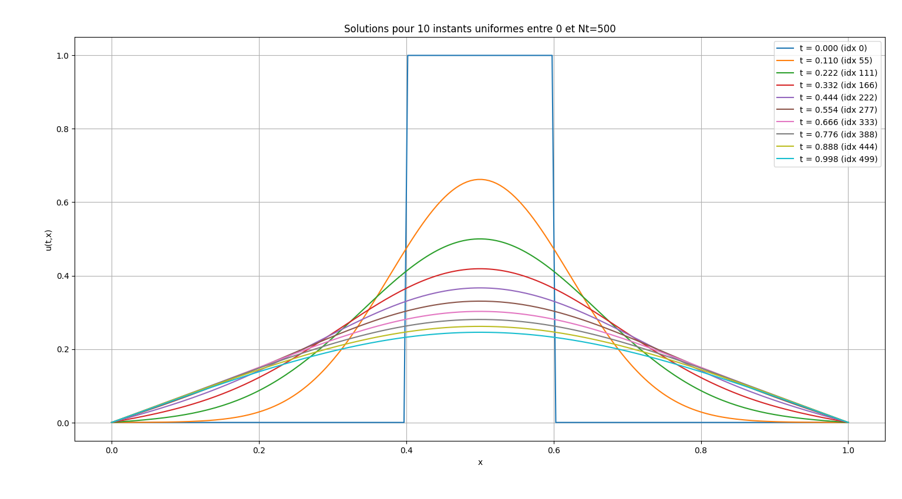
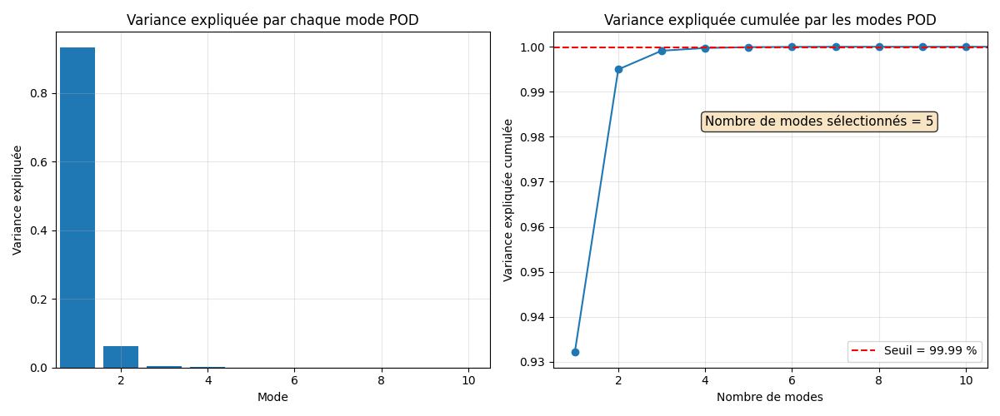
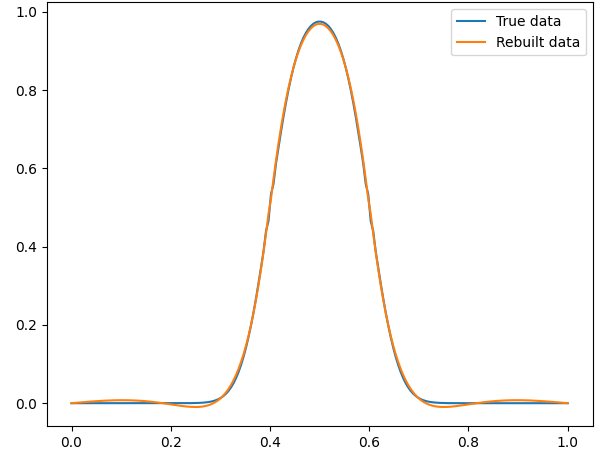

## Theoretical Background

The Mesh Morphing Gaussian Process (MMGP) framework combines several mathematical and computational techniques to construct surrogate models for physical fields defined on variable computational meshes. This section introduces the main theoretical concepts underlying the approach: **Proper Orthogonal Decomposition (POD)**, **Mesh Morphing**, and **Gaussian Process Regression (GPR)**.

### 1. Proper Orthogonal Decomposition (POD)

Proper Orthogonal Decomposition is a linear dimensionality reduction technique widely used in reduced-order modeling to represent high-dimensional physical fields through a limited number of dominant spatial modes.

Consider a collection of numerical simulations arranged in a snapshot matrix **U ∈ ℝ^(m × n)**, where:
- **m**: Number of simulation snapshots.
- **n**: Number of spatial degrees of freedom.

POD constructs an orthonormal basis of spatial modes that captures the dominant variations in the data. Each physical field can be approximated using a reduced number of POD modes:

**u⁽ⁱ⁾ ≈ Σₖ₌₁ʳ aₖ⁽ⁱ⁾ φₖ**

where:
- **φₖ**: The k-th POD spatial mode.
- **aₖ⁽ⁱ⁾**: Modal coefficient for simulation i.
- **r**: Number of retained POD modes.

The number of retained POD modes is selected according to the cumulative explained variance:

**ηᵣ = (λ₁ + λ₂ + ... + λᵣ) / (λ₁ + λ₂ + ... + λₙ)**

where:
- **λₖ**: Eigenvalue associated with the k-th POD mode.
- **r**: Number of retained modes.
- **n**: Total number of modes considered.

**Role in surrogate modeling**

Instead of directly predicting thousands of physical field values, a machine learning model can be trained to predict a small number of modal coefficients. The complete physical field is subsequently reconstructed using the reduced POD basis.

In this project, a **non-intrusive POD approach** is adopted: the governing physical equations are not projected onto the reduced basis. Instead, the reduced coefficients are learned through supervised regression. This considerably reduces the dimensionality of the model outputs.

### 2. Mesh Morphing and Geometrical Standardization

A major challenge in learning finite element solutions is that different simulations may be performed on meshes with varying geometries, numbers of nodes, and spatial discretizations. As a result, the corresponding physical fields cannot be directly compared or represented as fixed-dimensional outputs for supervised learning. **Mesh Morphing** addresses this issue by transforming computational meshes onto a common reference domain. Two relevant mesh transformation approaches are considered in this study:

- **Tutte-based parametrization:** Maps suitable meshes onto a reference domain, such as the unit disk.
- **Radial Basis Function (RBF) Mesh Morphing:** Uses radial basis functions to deform meshes toward a selected reference geometry.

The transformation preserves the mesh connectivity while modifying the nodal coordinates. However, mesh morphing alone does not necessarily produce identical discretizations, because basically the original meshes do not have the same number of nodes. A further interpolation step is therefore required in order to get a common representation of all the fields.

**Common Reference Mesh**

After geometrical transformation, the physical fields are transferred onto a common reference mesh using finite element interpolation. This procedure ensures that the different simulation outputs are represented on a shared spatial discretization and have consistent dimensions. The geometrical information is also preserved by transferring the original mesh coordinate fields onto the reference mesh. 

The resulting coordinate fields can then be compressed through POD, providing a reduced representation of the original geometry.

### 3. Gaussian Process Regression (GPR)

Gaussian Process Regression is a probabilistic supervised learning approach used to approximate unknown relationships between input parameters and output quantities.

A Gaussian Process is defined by a mean function and a covariance kernel:

**f(x) ~ GP(m(x), k(x, x′))**

where:
- **f(x)**: Unknown function to approximate.
- **m(x)**: Mean function.
- **k(x, x′)**: Covariance kernel.
- **GP**: Gaussian Process.

For deterministic numerical simulations, Gaussian Process Regression can provide accurate interpolation of training observations under suitable modeling assumptions.

An additional advantage is its ability to provide **predictive uncertainty estimates**, making it particularly useful for surrogate modeling.

Within the MMGP framework, Gaussian Process Regression is applied to the reduced coefficients of physical fields rather than to the complete high-dimensional simulation outputs.

### 4. Integration within the MMGP Framework

The MMGP methodology combines the previous techniques into a unified surrogate modeling workflow.

*Step 1* — Mesh Morphing : Transform the computational meshes onto a common reference domain.

*Step 2* — Field Interpolation : Transfer physical and geometrical fields onto a shared reference mesh.

*Step 3* — Dimensionality Reduction : Apply POD to obtain compact representations of the geometric coordinate fields and physical quantities of interest.

*Step 4* — Supervised Learning : Train Gaussian Process models to predict the reduced coefficients of the physical fields using the physical input parameters and reduced geometrical information.

*Step 5* — Physical Field Reconstruction : Reconstruct the predicted physical fields through inverse POD and transfer them back to the target computational mesh.

The resulting framework provides a way to learn high-dimensional finite element solutions while accounting for geometrical variability.

### 5. Preliminary Validation on a Simple Test Case

Before applying the methodology to the industrial problem, a preliminary study was conducted on a one-dimensional heat equation. The objective was to validate the main components of the reduced-order modeling workflow on a simple benchmark problem.

The study involved:

- Numerical resolution of the heat equation using finite differences.
- Extraction of dominant spatial modes through POD.
- Selection of the retained modes according to the explained variance.
- Comparison of Gaussian Process and Radial Basis Function regression for predicting modal coefficients.
- Reconstruction of the physical solution using the predicted coefficients.

Figure 1 shows the evolution of the 1D heat equation solution at different time steps, highlighting the temporal dynamics of the system:

  

  <em>Figure 1. Evolution of the one-dimensional heat equation solution at different time steps.</em>

Figure 2 presents the selection of the POD modes based on the cumulative explained variance, demonstrating that only a limited number of modes is required to capture almost all of the information contained in the dataset.

  

  <em>Figure 2. POD mode selection based on cumulative explained variance.</em>

Figure 3 illustrates the reconstruction of the solution at a previously unseen time step using the surrogate model, allowing a direct comparison between the predicted and reference solutions.

  

  <em>Figure 3. Comparison between the reference solution and the surrogate model prediction at an unseen time step.</em>

For this simplified problem, five POD modes captured 99.99% of the explained variance. Gaussian Process Regression provided the best performance among the regression approaches tested, while extrapolation remained challenging.

This preliminary study validated the reduced-order modeling pipeline and provided a useful proof of concept before extending the methodology to the industrial multiphysics case.

The following section presents the development of the surrogate modeling approach and the experimental choices investigated for the industrial application.
