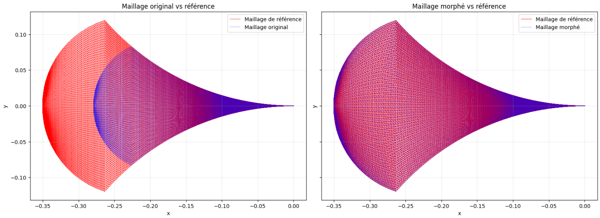
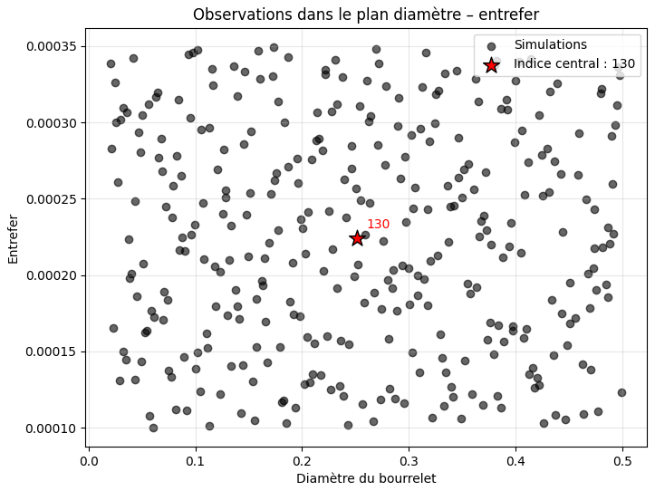
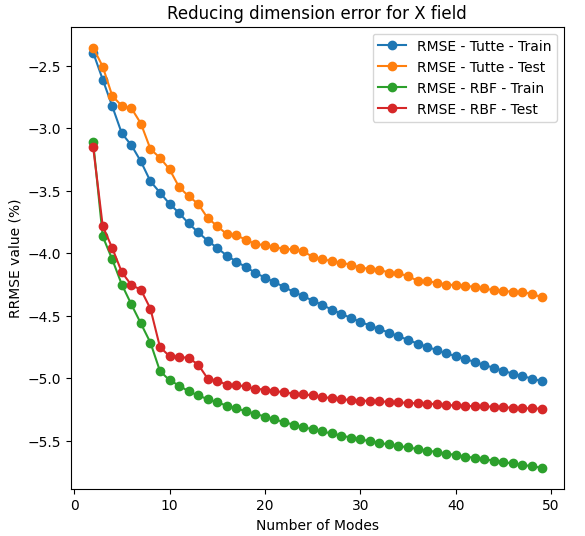
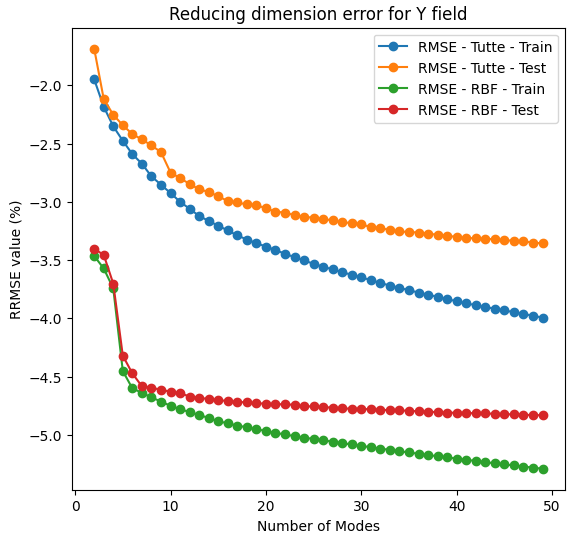

## Proposed Methodology & Experimental Design

The development of the surrogate model involves several stages, from experimental design and finite element data generation to mesh standardization, dimensionality reduction, and Gaussian Process Regression.

Particular attention is given to the methodological choices affecting the quality of the physical field representations and the predictive performance of the surrogate models.

### 1. Input Parameters and Experimental Design

The numerical model depends on a set of physical and geometrical parameters describing the manufacturing process. For this study, **eight input parameters** are considered:

- **Six physical parameters** governing the behavior of the material and the physical conditions of the process.
- **Two geometrical parameters** controlling the shape of the computational domain.

The remaining parameters are held constant throughout the experiments.

Because generating high-fidelity simulations is computationally expensive, an efficient sampling strategy is required to construct a representative training dataset. A **Latin Hypercube Sampling (LHS) design with optimized discrepancy** is selected to improve the coverage of the multidimensional parameter space. The experimental dataset consists of:

- **350 training simulations**
- **25 independent test simulations**

The training and test sets are generated using separate experimental designs to promote adequate coverage of the parameter space in both datasets. The resulting samples are inspected through their marginal distributions and two-dimensional projections to assess their spatial distribution across the input domain. The Figure 1 presents a part of these projections :

  

  <em>Figure 1. A part of the two-dimensional projections of the designs of experiments</em>

### 2. High-Fidelity Simulation Data

For each sampled parameter configuration, a finite element simulation is performed to compute the corresponding physical fields. The quantities of interest include :

- Temperature fields
- Pressure fields
- Velocity fields

These numerical solutions provide the reference data for training and evaluating the surrogate models. However, the simulations are performed on geometrically varying computational domains, resulting in meshes with different spatial discretizations. A geometrical standardization procedure is therefore required before applying dimensionality reduction and supervised learning.

### 3. Mesh Morphing Strategies and Reference Mesh Selection

One of the main methodological investigations concern the choice of the reference domain used to standardize the computational meshes. Two strategies are considered:

**Strategy A — Tutte Mapping to the Unit Disk**

This approach maps each computational mesh onto a common canonical domain using Tutte-based parametrization. The unit disk provides a simple and standardized reference geometry, but the transformation may introduce substantial geometrical deformation relative to the original physical domain. In our case, the reference domain is the unit circle, as shown in the Figure 1 presents this domain with the reference mesh on it :

  

  <em>Figure 1. The reference mesh in case of Tutte barycentric algorithm for mesh morphing </em>

**Strategy B — RBF Mesh Morphing to a Representative Geometry**

This approach uses Radial Basis Function interpolation to map the computational meshes toward a reference domain selected from the available simulation geometries. By choosing a geometrically representative domain, the transformation aims to limit geometrical distortion and preserve the spatial organization of the physical fields.

  

  <em>Figure 2. The RBF mesh morphing to the reference domain </em>

#### Reference Geometry Selection

Five candidate geometries are selected from the training set and evaluated using approximately twenty representative computational meshes. The comparison focuses on criteria related to:

- Preservation of geometrical properties.
- Quality of the transformed meshes.
- Preservation of physical field regularity.
- Distortion introduced during field transport.

In particular, the spatial gradients of the physical fields are examined through an H1-based seminorm to evaluate how the transformations affect their regularity. Since no candidate geometry consistently outperforms the others across all criteria, a compromise-based selection was adopted : a **median representative geometry** was retained as the reference domain for further experiments, the Figure 3 shows the position of the selected reference mesh in the plan of the two geometrical parameters :

  

  <em>Figure 3. The position of the selected reference mesh in the plan of the two geometrical parameters </em>

#### Comparison of the Two Morphing Strategies

The unit-disk approach and the representative-geometry approach are subsequently compared in terms of physical field preservation and compatibility with dimensionality reduction. The analysis shows that both strategies provide comparable overall preservation of the transported physical information. But, a key criteria is the compressibility of the information.

  

  <em>Figure 4. The compressibility of the field of the coordinates x in both cases </em>

  

  <em>Figure 5. The compressibility of the field of the coordinates y in both cases </em>

**RBF morphing toward the median reference geometry produces fields that were more efficiently compressed using POD**, particularly for the geometrical coordinate fields. This observation motivates the selection of the median reference geometry for the subsequent surrogate modeling experiments.

### 4. Physical Field Transport and Interpolation

Following mesh morphing, the physical fields associated with each simulation are transferred onto the transformed meshes and interpolated onto a common reference discretization. This procedure provides a consistent representation of all simulation outputs, allowing comparisons between physical fields and enabling dimensionality reduction. Visual inspections are performed to verify that the interpolation and geometrical transformations preserved the main physical structures of the temperature, pressure, and velocity fields.

FIGURE OF THE FIELDS AFTER THE STANDARDIZATION

### 5. Dimensionality Reduction Using POD

Once the numerical fields are represented on the common reference mesh, Proper Orthogonal Decomposition is applied to reduce their dimensionality. 

Two categories of information are compressed:

- **Geometrical information:** The spatial coordinate fields describing the original computational geometries.
- **Physical information:** The temperature, pressure, and velocity fields obtained from the finite element simulations.

The number of retained POD modes is investigated using two complementary criteria:

1. Cumulative explained variance.
2. Reconstruction error, evaluated using the Relative Root Mean Square Error (RRMSE).

Although explained variance provides an initial indication of the amount of information retained, reconstruction errors are also examined to avoid selecting an insufficient number of modes.
For the geometrical coordinate fields, **six POD modes are retained for each coordinate**, corresponding to the point beyond which the reconstruction errors and their variability tend to stabilize. The physical fields are similarly represented through reduced modal coefficients, which subsequently serve as the target outputs of the regression models.

### 6. Gaussian Process Surrogate Model Configurations

Two surrogate modeling formulations are developed and compared.

**Model A — Parametrized MMGP**

The first formulation directly uses the eight original input parameters:

- Six physical parameters.
- Two explicit geometrical parameters.

This representation exploits the fact that the computational geometries are fully described by a small number of known parameters. Its main advantage is a compact input space, which is particularly relevant for Gaussian Process Regression.

**Model B — Classical MMGP**

The second formulation follows the original geometry-based MMGP approach more closely. Instead of relying directly on the explicit geometrical parameters, the model uses reduced POD coefficients of the coordinate fields to describe geometrical variability. This representation is more flexible and can potentially be extended to geometries without an explicit low-dimensional parametrization.

For both formulations, Gaussian Process models are trained to predict the reduced coefficients of the physical quantities of interest.

A **Matérn 5/2 covariance kernel** waiss adopted for the regression models. 

Each output modal coefficient is predicted independently, and the corresponding physical fields are reconstructed using the POD basis. The two formulations are subsequently evaluated to investigate the influence of geometrical representation on prediction accuracy. The comparative results and limitations of these models are discussed in the following section.
