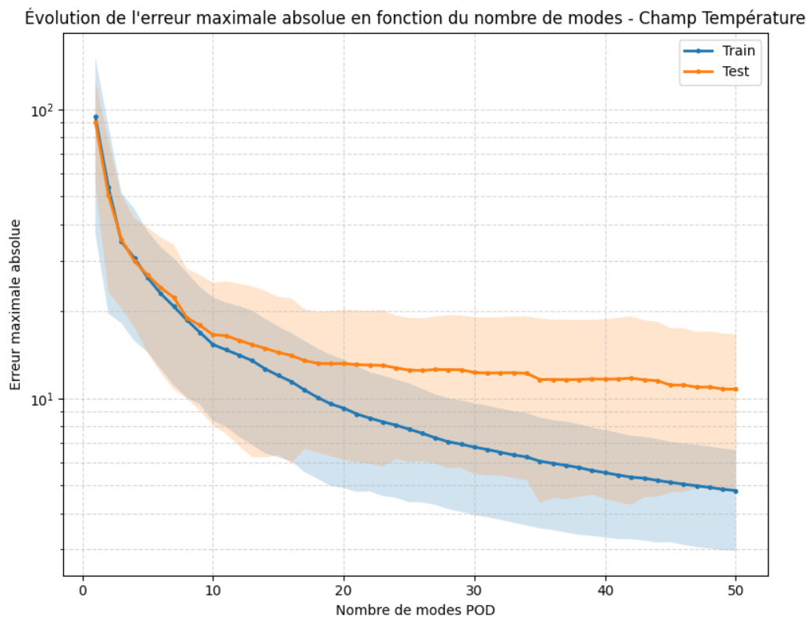
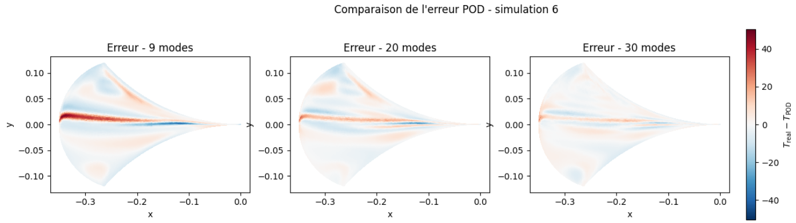
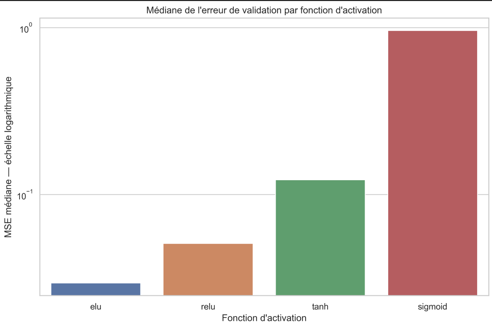
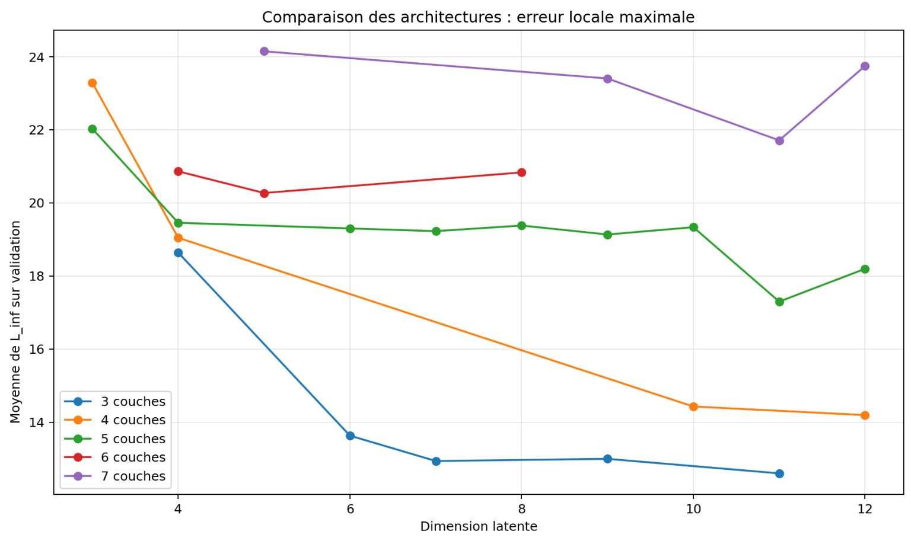
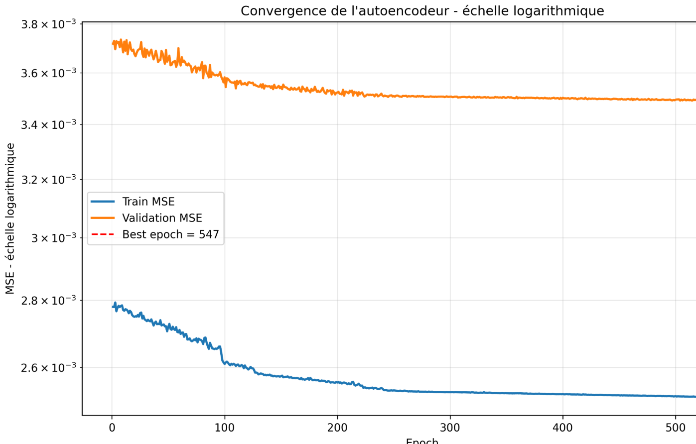
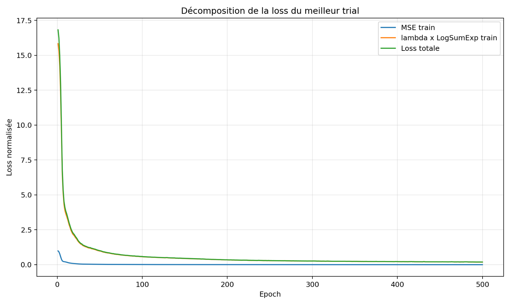
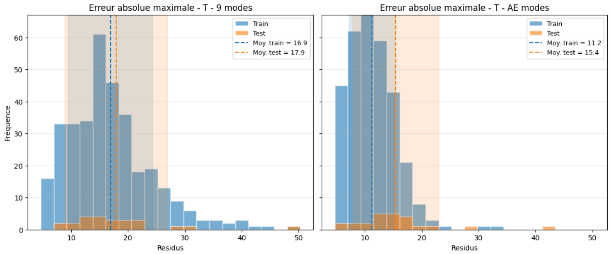
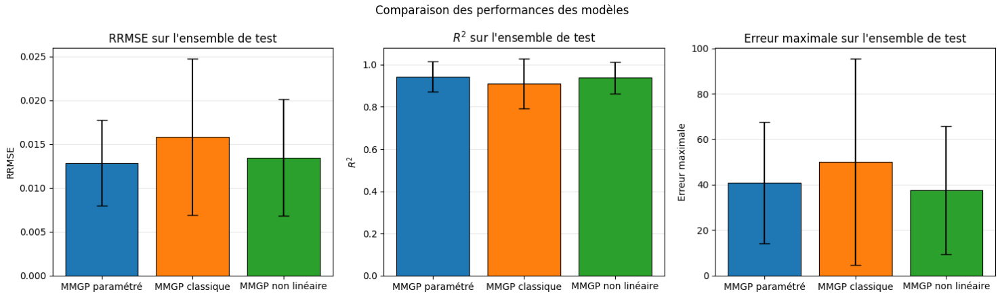

## Nonlinear Dimensionality Reduction with Autoencoders

### 1. Motivation: Beyond Linear Dimensionality Reduction

The previous experiments highlighted an important limitation of POD-based surrogate modeling: although the dominant spatial structures were accurately reconstructed, significant errors persisted in regions characterized by strong localized variations.

Proper Orthogonal Decomposition provides an optimal linear representation under a global reconstruction criterion. However, physically important localized structures may contribute relatively little to the overall variance of the data. Consequently, increasing the number of POD modes does not necessarily lead to significant improvements in local reconstruction accuracy. As illustrated in *Figure 1*, the maximum reconstruction error on the test set eventually plateaus at a relatively high value, despite the increasing number of retained POD modes.

  

  <em>Figure 1. Evolution of the distribution of maximum absolute reconstruction errors
for linear POD with regard to the number of POD modes.</em>

  

  <em>Figure 2. Evolution of the residuals field with regard to the number of the POD modes for a simulation in the test set.</em>

To address this limitation, a **nonlinear dimensionality reduction approach based on autoencoders** was investigated. The objective was to obtain a more expressive low-dimensional representation of the temperature fields while reducing the largest local reconstruction errors.

Unlike POD, which projects the data onto a linear subspace, autoencoders learn nonlinear transformations through neural networks.

### 2. Autoencoder-Based Dimensionality Reduction

In this study, the autoencoder is applied to temperature fields represented on the common reference mesh. The network is designed to learn a compact representation of these fields while preserving both their overall spatial behavior and their localized thermal structures.
The resulting latent variables could subsequently replace the POD coefficients as prediction targets for Gaussian Process Regression.

### 3. Reconstruction Loss and Local Error Penalization

A central challenge in training the autoencoder is the selection of an appropriate reconstruction loss function.

**Initial approach: Mean Squared Error**

The first experiments used the conventional Mean Squared Error (MSE), which measures the average squared difference between the reconstructed and reference fields. Although MSE is effective in capturing global structures, it does not explicitly prioritize the largest localized errors. A model can therefore achieve a relatively low MSE while producing substantial errors in critical regions.

**Proposed approach: Hybrid Reconstruction Loss**

To address this issue, we define a hybrid loss function, combining:

1. A global MSE reconstruction term.
2. An additional penalty targeting large local reconstruction errors.

The objective can be expressed as:

**Total Loss = MSE + λ × Local Error Penalty**

The local penalty is constructed using a smooth LogSumExp-based approximation of the maximum absolute reconstruction error, allowing gradient-based optimization.

Two parameters control this formulation:

- **λ:** Controls the importance assigned to the local error penalty.
- **α:** Controls the smooth approximation of the maximum absolute error.

The values selected empirically for the experiments are:

- **λ = 5**
- **α = 10**

This loss formulation aims to balance global reconstruction accuracy with improved representation of localized physical phenomena.

### 4. Architecture Optimization and Activation Function Selection

The performance of the autoencoder depends strongly on architectural and training hyperparameters. Several configurations are investigated by varying:

- Latent space dimension.
- Number of hidden layers.
- Learning rate.
- Activation function.

An initial grid-search investigation was performed to compare candidate configurations using validation reconstruction errors.

**Activation Function Comparison**

Four activation functions were evaluated:

- ReLU
- ELU
- Tanh
- Sigmoid

The initial experiments use MSE as the reconstruction objective. Among the tested activation functions, **ELU consistently achieves the lowest validation errors**.

  

  <em>Figure 3. Comparison of the validation error for the different activation values.</em>

However, this initial MSE-based approach does not sufficiently improve local reconstruction accuracy compared with POD, motivating the introduction of the hybrid loss function.

### 5. Optimizing the Autoencoder for Local Reconstruction

A second experimental investigation focuses on reducing the maximum absolute reconstruction error using the hybrid loss. A randomized hyperparameter search is conducted to study the influence of network depth and latent space dimension.

The experiments reveal that increasing network depth did not systematically improve performance. In particular, architectures containing six or seven hidden layers produced higher local reconstruction errors than shallower alternatives. The *Figure 4*

  

  <em>Figure 4. Results of the randomized hyperparameters.</em>

  

  <em> Figure 5. Convergence of the autoencoder for the train and validation sets </em>

Among the evaluated configurations, the best results were obtained using **three hidden layers and a latent dimension of 11**.

The decoder reconstructs the temperature field from the resulting 11-dimensional latent representation.  The following figure illustrates the convergence of the selected autoencoder during training, showing the evolution of the total loss function and its individual components over successive epochs.

  

  <em> Figure 6. Evolution of the hybrid training loss for the selected autoencoder architecture. The total loss is decomposed into the global MSE reconstruction term and the weighted LogSumExp penalty targeting large local errors.</em>

### 6. Reconstruction Performance: Autoencoder vs. POD

After selecting the autoencoder architecture, its reconstruction performance is then compared with the linear POD representation. The comparison focuses on the distribution of maximum absolute reconstruction errors across training and test simulations.

  

  <em> Figure 7. Distribution of maximum absolute reconstruction errors
for linear POD and nonlinear autoencoder representations.</em>

The nonlinear autoencoder generally achieves lower mean maximum reconstruction errors than POD on both datasets. This improvement suggests that the learned nonlinear latent representation is better suited to capturing certain localized thermal structures. However, some configurations continue to exhibit relatively large reconstruction errors. Additionally, both methods perform slightly better on training data than on unseen test simulations.

These observations indicate that nonlinear dimensionality reduction can improve local reconstruction quality, but does not completely eliminate the difficulty of representing strongly localized phenomena.

### 7. Integration into the MMGP Framework

The optimized autoencoder is subsequently integrated into the surrogate modeling pipeline. The resulting model, referred to as **Nonlinear MMGP**, replaces the POD-based representation of the temperature field with the learned nonlinear latent representation.

The workflow consists of:

1. Compressing the temperature fields using the trained autoencoder.
2. Training Gaussian Process models to predict the latent coordinates from the eight physical and geometrical input parameters.
3. Reconstructing the predicted temperature fields using the trained decoder.

The input representation is based on the parametrized MMGP formulation, which had demonstrated better predictive performance than classical MMGP in the previous experiments.

**Comparison with POD-Based MMGP**

The nonlinear formulation is evaluated against the parametrized POD-based MMGP using the same global and local prediction metrics.

  

  <em> Figure 8. Comparison of the three models.</em>

Both approaches reproduce the overall temperature distribution and the location of the hottest regions. For the representative simulation examined, Nonlinear MMGP produces smaller local residuals in regions characterized by strong thermal gradients. However, the nonlinear formulation also generates less spatially regular error patterns. Across the full test dataset, the two models achieve comparable global prediction accuracy, while nonlinear MMGP exhibits a lower mean maximum absolute error.

Nevertheless, the dispersion intervals of the evaluation metrics overlap substantially, preventing a clear conclusion that the nonlinear formulation consistently outperform the parametrized POD-based approach. Furthermore, **mean maximum prediction errors remained above 30°C**, which is still insufficient for the accuracy requirements of the industrial application.

### 8. Discussion and Main Findings

The investigation of nonlinear dimensionality reduction led to several important findings:

1. **Nonlinear representations improved local reconstruction:** The autoencoder reduced the mean maximum reconstruction error compared with POD.

2. **Loss function design was critical:** Introducing a local error penalty improved the representation of strongly localized temperature variations.

3. **Larger networks were not necessarily better:** A relatively shallow architecture with three hidden layers provided the best results among the configurations tested.

4. **Improved compression did not guarantee sufficient prediction accuracy:** Although the nonlinear latent representation improved reconstruction, Gaussian Process prediction errors remained significant.

5. **A trade-off emerged between local accuracy and spatial regularity:** The nonlinear approach reduced some localized errors but could produce less regular reconstructed fields.

Overall, these experiments demonstrate the potential of combining nonlinear dimensionality reduction with Gaussian Process Regression for high-dimensional surrogate modeling. However, the remaining prediction errors indicate that further research is necessary before the approach can satisfy the precision requirements of the considered industrial application.
